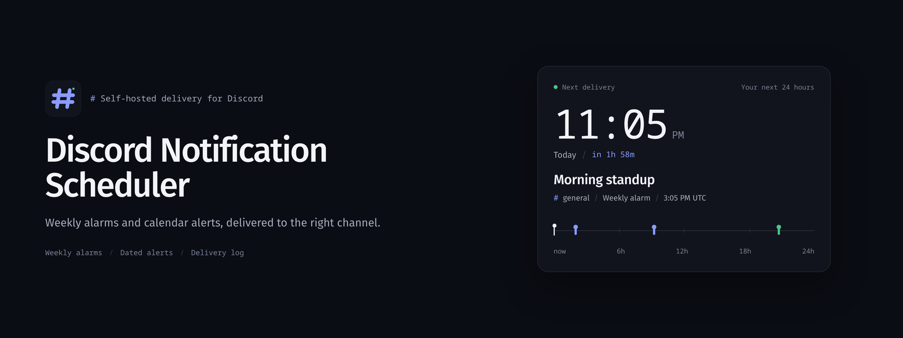
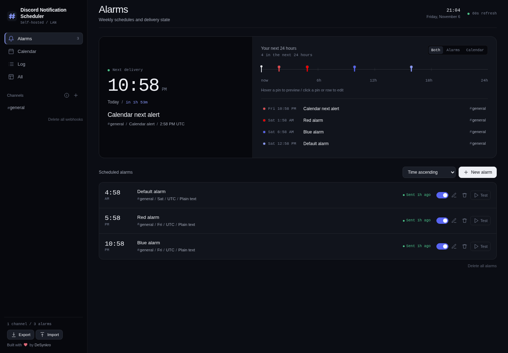
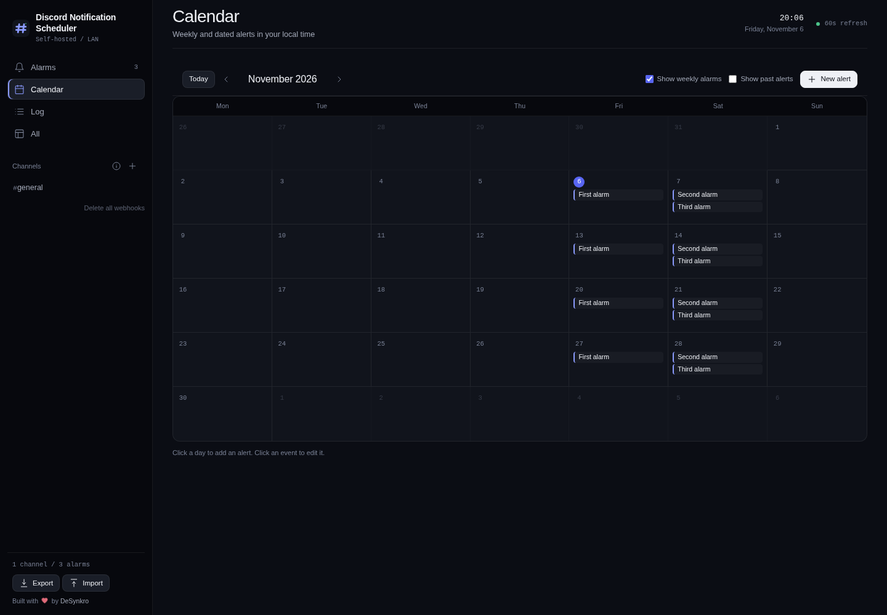
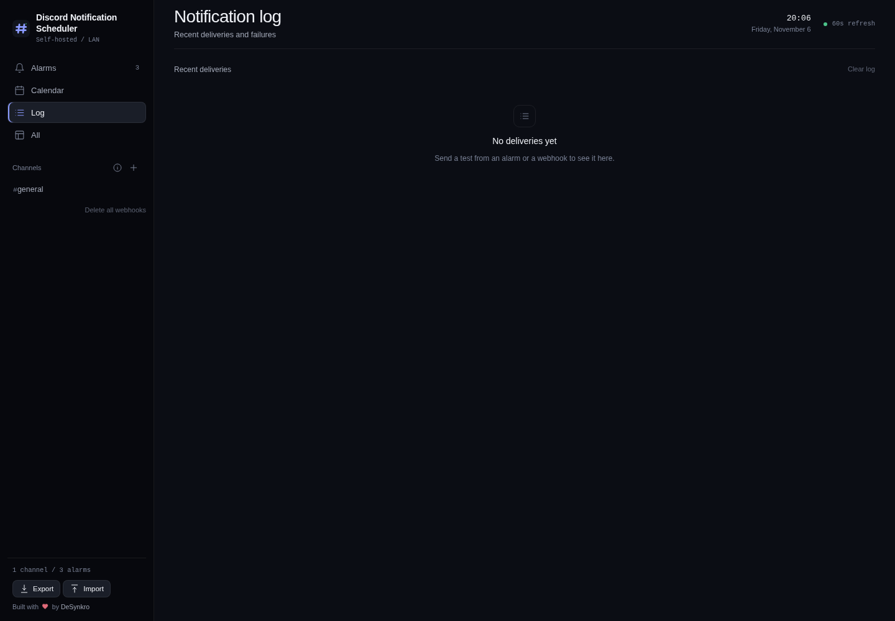
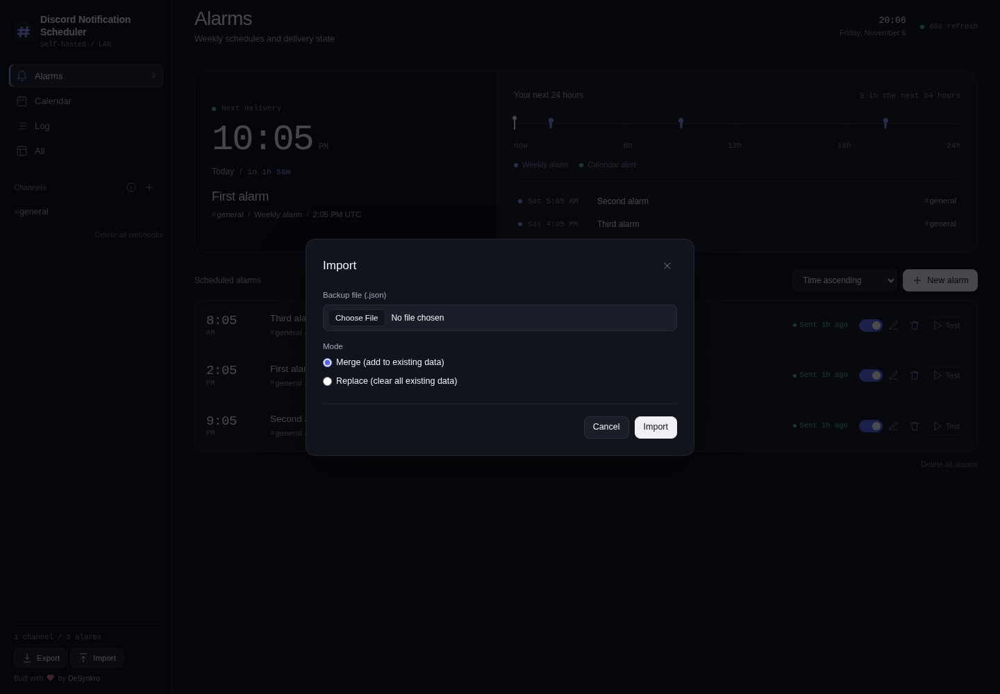
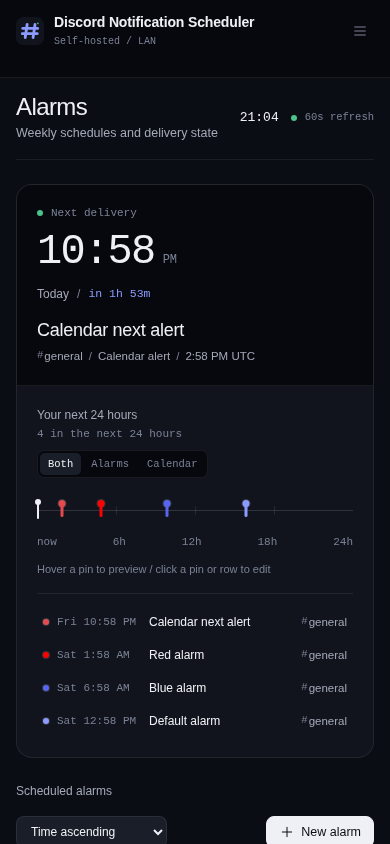
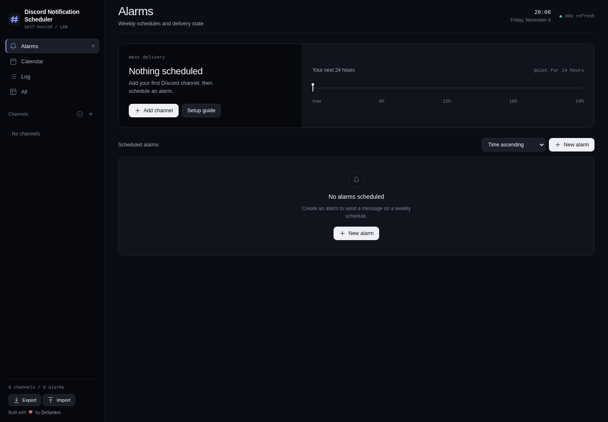

<p align="center">
  
</p>

<p align="center">
  <strong>A self-hosted web app to schedule and send Discord webhook messages at specific
  times or dates.</strong><br> Runs entirely in Docker with no host dependencies.
</p>

<p align="center">
  <a href="https://codeberg.org/DeSynkro/discord-notification-scheduler/src/branch/main/LICENSE"></a>
  <a href="VERSION"></a>
  <a href="https://ko-fi.com/desynkro"></a>
</p>

<p align="center">
  Built by <a href="https://desynkro.com">DeSynkro</a>
  with assistance from <a href="https://opencode.ai">Opencode</a>.
</p>

<p align="center">A self-hosted control room for scheduled Discord messages. Set weekly alarms or calendar alerts, send text or embeds to any channel, and keep the schedule, history, and webhook URLs on your own hardware. One Docker container, plain JSON, no telemetry.</p>

<p align="center">
  Made with love for the community, and a special thank you to everyone who was
  welcoming and kind, it means a lot.
</p>

## Requirements

- [Docker](https://docs.docker.com/engine/install/) with the Compose plugin

## Quick start

### First time

```bash
git clone https://codeberg.org/DeSynkro/discord-notification-scheduler.git
cd discord-notification-scheduler
mkdir -p data
docker compose up -d
```

Open [http://localhost:9001](http://localhost:9001)

### Update to latest version

```bash
git pull
docker compose up --build -d
```

**Webhook URLs** must match the Discord format:
`https://discord.com/api/webhooks/<id>/<token>`

## Setting up a Discord Webhook

1.  Open a server you manage (or have "Manage Webhooks" permission in)
2.  Go to **Server Settings** > **Integrations** > **Webhooks**
3.  Click **Create Webhook**
4.  Give it a name and select the channel where messages will appear
5.  Copy the webhook URL. It looks like:
    `https://discord.com/api/webhooks/123456789/abc-xyz...`
6.  Return to the app, open **Channels** in the sidebar, click **Add**, and paste the URL

> Webhooks can only be created in servers, not in direct messages.
> You need "Manage Webhooks" permission on the server.

## Screenshots

<p align="center">
  
  
</p>
<p align="center">
  
  
</p>
<p align="center">
  
  
</p>


## Why this exists

It's a funny story why I came up with this in the first place.
My sister in law was working on her portfolio, and she asked me to remind her every day for her to do her portfolio because she needed it done.

After the first three days, I got tired of messaging her. So I did what every normal person would do... I started working on this app to do it for me.

Now I have a Discord Webhook set up on her server tagging her every single day for her to do her portfolio.

There are plenty of hosted services that can trigger webhooks on a schedule. But they require trust. Trust that your webhook URL wont be logged, trust that your message content isn't mined, trust that the service will be around next month.

This project flips that. You run it on your own machine, your own network, your own terms. No signup, no API keys to a third party, no vendor lock-in.

Just Docker and a JSON file you can copy with one command.

## Features

-   **Self-hosted and private** - runs on your hardware, zero cloud
    dependencies
-   **Zero telemetry** - no analytics, no tracking, no phone-home, no CDN
-   **Your data, your rules** - channels, alarms, and calendar alerts stored
    as plain JSON, fully portable, backup by copying one folder
-   **SSRF-safe** - webhook URLs validated against Discords exact pattern;
    no arbitrary outbound requests
-   **Minimal outbound traffic** - the only data leaving your machine is the
    message you scheduled, delivered to Discord over HTTPS; no CDN, no font
    hosts, no third-party servers
-   One `docker compose up` and done
-   Dark control-room UI with a live next-delivery board and 24-hour rail
-   Calendar alerts with one-time, daily, weekly, monthly, and yearly repeats
-   Per-alert color for alarms and calendar alerts, used on the rail pin and in the Discord embed
-   Show weekly alarms toggle on the calendar
-   Month grid with month navigation and a day list
-   Sidebar navigation for channels, alarms, calendar, and the notification log
-   Notification log of scheduled sends and manual tests, kept locally
-   Plain text and rich embed messages (title and color)
-   Per-alert timezone override with searchable autocomplete
-   Markdown preview in the compose form
-   60-second polling loop, no external cron needed
-   429 rate-limit handling with Retry-After backoff
-   Test buttons for alarms, calendar alerts, and channels

## Calendar alerts

Open **Calendar** in the sidebar to see a month grid. Weekly alarms appear on
their weekdays in their alarm colors; dated alerts appear in their own colors.

-   Click a day to create an alert for that date
-   Click an event to edit it
-   Pick a color for each calendar alert
-   Use the Show weekly alarms checkbox to hide or show the weekly projections.
    The choice is remembered across reloads.
-   Use the day list when a day has more than three events
-   Fired and past calendar alerts are hidden by default; the Show past alerts
    checkbox reveals them
-   Repeat can be one-time, daily, weekly, monthly, or yearly
-   One-time alerts deactivate after they fire
-   Monthly and yearly repeats clamp to the last valid day when needed

The **Log** view shows recent sends from weekly alarms, calendar alerts, and
manual tests. It keeps the newest 500 entries and is not included in exports.
Entries are shown 10 per page.

## What data is stored?

| Kept | Not kept |
|------|----------|
| Webhook URL (Discord endpoint) | No analytics |
| Alarm and calendar schedules, and message content | No telemetry of any kind |
| Last-fired and last-error timestamps | No logs sent off your machine |
| Notification log, newest 500 entries, local only | No user accounts, emails, or IPs |
| | No cookies, no fingerprinting |

The only network request leaving your network is the webhook POST to Discord.
HTMX and all other assets are served directly from the app itself, with no CDN,
analytics, or third-party servers contacted on page load.

## Tech Stack

| Layer | How |
|-------|-----|
| Backend | Python 3.12 + FastAPI |
| Frontend | HTMX + Jinja2 (no JavaScript framework) |
| Styling | CSS, ink control-room theme, no framework |
| Scheduler | APScheduler (AsyncIOScheduler, 60s polling loop) |
| HTTP | httpx (async) |
| Validation | Pydantic v2 |
| Container | Docker / Docker Compose (single container) |
| Persistence | Plain JSON files (no database) |

## Troubleshooting

### Permission errors on data/

The container runs as uid 1001 and needs write access to `./data/`. The
entrypoint makes the mounted folder writable before dropping privileges, so a
fresh bind mount created by Docker as root should just work.

If you still see permission errors, for example because you run the app outside
Docker or the files themselves are read-only, give the data folder to the app
user:

```bash
mkdir -p data
sudo chown -R 1001:1001 data/
```

This only needs to run once (or after you delete and recreate the data folder).

### Port conflict

The dashboard listens on port 9001. To change it, edit the `ports:` line in
`docker-compose.yml`:

```yaml
ports:
  - "9001:9001"    # change left side to your preferred port
```

## Development

Python 3.12 and Docker are the supported environment.

```bash
python3 -m venv .venv
.venv/bin/pip install -r requirements.txt -r requirements-dev.txt
.venv/bin/pytest
```

The test suite covers recurrence edge cases, validation, the log cap, calendar
routes, the grid, import and export, and the Origin check.

## License

GNU General Public License v3.0 or later. See [LICENSE](LICENSE).

## Credits

-   Built by [DeSynkro](https://desynkro.com)
-   Assisted by [Opencode](https://opencode.ai)
-   Thank you to the self-hosted communities for being welcoming

<p align="center">
  <a href="https://desynkro.com" target="_blank">
    
  </a>
</p>
