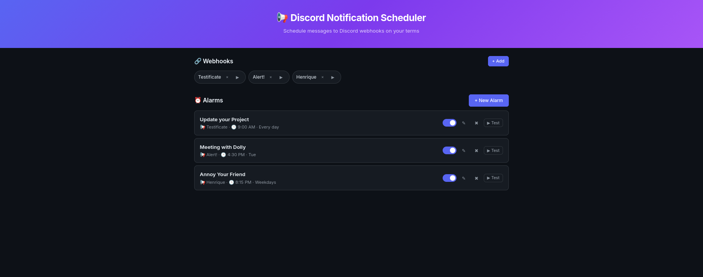

# Discord Notification Scheduler

A self-hosted web app to schedule and send Discord webhook messages at specific
times. Runs entirely in Docker with no host dependencies.

[](LICENSE)

Built by [DeSynkro](https://desynkro.com) with assistance from
[Opencode](https://opencode.ai). Made with love for the community, and a special
thank you to everyone who was welcoming and kind, it means a lot.

## Requirements

- [Docker](https://docs.docker.com/engine/install/) with the Compose plugin

## Quick start

### First time

```bash
git clone https://codeberg.org/DeSynkro/discord-notification-scheduler.git
cd discord-notification-scheduler
mkdir -p data
sudo chown -R 1001:1001 data/
docker compose up -d
```

Open [http://localhost:9001](http://localhost:9001)

### Update to latest version

```bash
git pull
docker compose up --build -d
```

**Webhook URLs** must match the Discord format:
`https://discord.com/api/webhooks/<id>/<token>`

## Screenshots



## Why this exists

There are plenty of hosted services that can fire a webhook on a schedule. but
they require trust, trust that your webhook URL wont be logged, trust that
your message content isn't mined, trust that the service will be around next
month.

This project flips that. You run it on your own machine, your own network,
your own terms. No signup, no API keys to a third party, no vendor lock-in.
Just Docker and a JSON file you can copy with one command.

## Features

-   **Self-hosted and private** - runs on your hardware, zero cloud
    dependencies
-   **Zero telemetry** - no analytics, no tracking, no phone-home, no CDN
-   **Your data, your rules** - webhooks and alarms stored as plain JSON,
    fully portable, backup by copying one folder
-   **SSRF-safe** - webhook URLs validated against Discords exact pattern;
    no arbitrary outbound requests
-   **Minimal outbound traffic** - the only data leaving your machine is the
    message you scheduled, delivered to Discord over HTTPS
-   One `docker compose up` and done
-   Dark-themed web UI using HTMX and FastAPI
-   Plain text and rich embed messages (title, optional color picker)
-   Per-alarm timezone override with searchable autocomplete
-   Markdown preview in the compose form
-   60-second polling loop, no external cron needed
-   429 rate-limit handling with Retry-After backoff
-   Test button to fire any alarm or webhook on demand

## What data is stored?

| Kept | Not kept |
|------|----------|
| Webhook URL (Discord endpoint) | No analytics |
| Alarm schedule and message content | No telemetry of any kind |
| Last-fired and last-error timestamps | No logs sent anywhere |
| | No user accounts, emails, or IPs |
| | No cookies, no fingerprinting |

The only network request your server will ever make is the webhook POST to
Discord. Nothing else.

## Tech Stack

| Layer | How |
|-------|-----|
| Backend | Python 3.12 + FastAPI |
| Frontend | HTMX + Jinja2 (no JavaScript framework) |
| Styling | CSS with dark theme and subtle gradients |
| Scheduler | APScheduler (AsyncIOScheduler, 60s polling loop) |
| HTTP | httpx (async) |
| Validation | Pydantic v2 |
| Container | Docker / Docker Compose (single container) |
| Persistence | Plain JSON files (no database) |

## Project structure

```text
├── docker-compose.yml      Single service, port 9001
├── Dockerfile              python:3.12-slim, non-root (uid 1001)
├── requirements.txt        Python dependencies
├── .gitignore              Git rules
├── LICENSE                 GPL v3
├── README.md               This file
├── thumbnail.png           Project screenshot
├── app/
│   ├── __init__.py
│   ├── main.py             FastAPI routes and HTMX handlers
│   ├── models.py           Pydantic schemas with validation
│   ├── storage.py          Thread-safe atomic JSON read/write
│   ├── scheduler.py        60-second polling loop
│   ├── discord.py          Async webhook sender with rate-limit handling
│   ├── templates/
│   │   └── index.html      Single-page dashboard
│   └── static/
│       └── style.css       Dark theme styles
└── data/                  Auto-created at startup (gitignored)
    ├── alarms.json
    └── webhooks.json
```

## Troubleshooting

### Permission errors on data/

The container runs as uid 1001 and needs write access to `./data/`. If you see
permission errors, the files are likely owned by your host user:

```bash
mkdir -p data
sudo chown -R 1001:1001 data/
```

This only needs to run once (or after you delete and recreate the data folder).

### Port conflict

The dashboard listens on port 9001. To change it, edit the `ports:` line in
`docker-compose.yml`:

```yaml
ports:
  - "9001:9001"    # change left side to your preferred port
```

## License

GNU General Public License v3.0 or later. See [LICENSE](LICENSE).

## Credits

-   Built by [DeSynkro](https://desynkro.com)
-   Assisted by [Opencode](https://opencode.ai)
-   Thank you to the self-hosted and Discord communities for being welcoming
